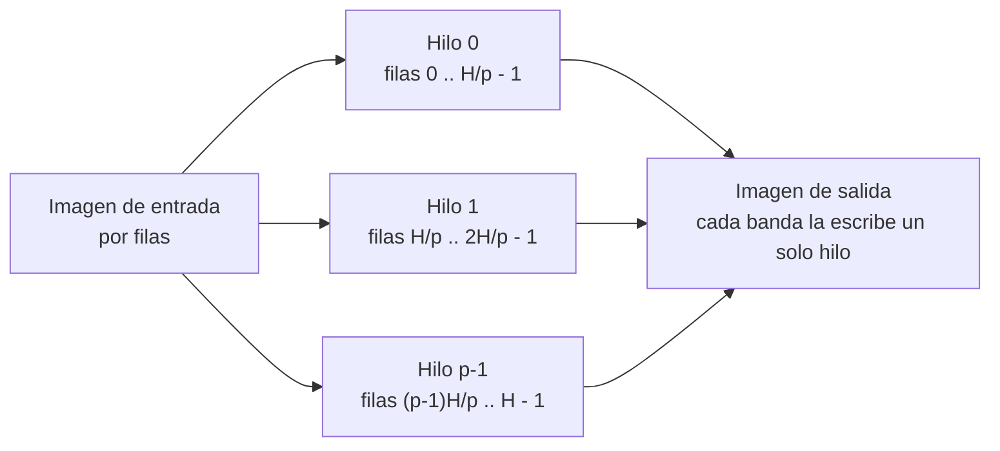
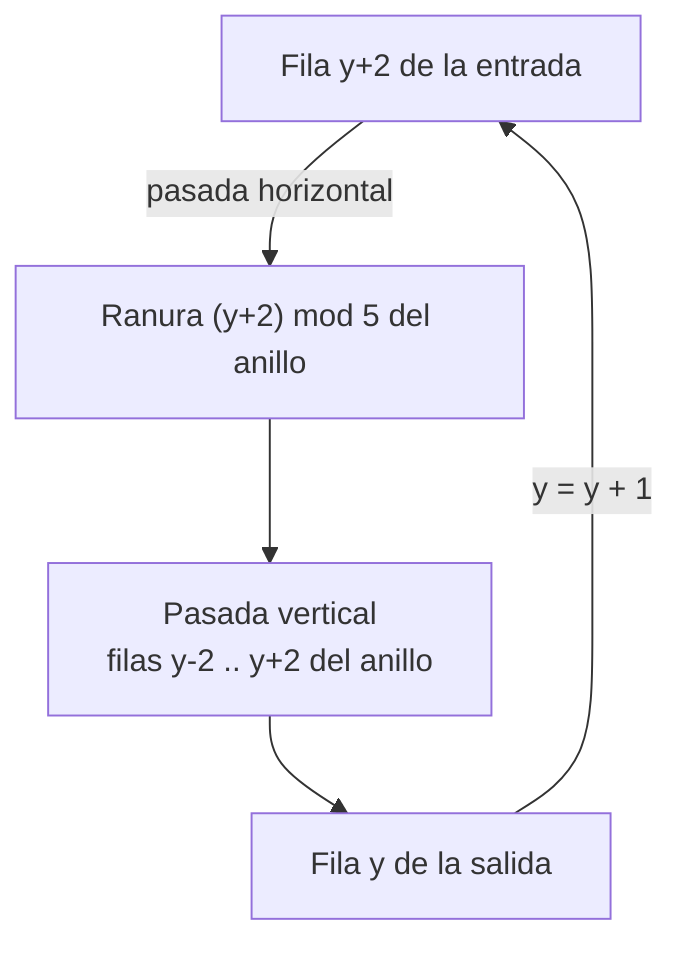

# El motor

## Desenfoque gaussiano separable

El núcleo binomial $k = \frac{1}{16}[1\;4\;6\;4\;1]$ se aplica en dos pasadas.
La horizontal lee la imagen de entrada y deja una imagen intermedia $T$ en
`double`; la vertical lee $T$ y escribe la salida redondeada:

$$
T(x, y) = \sum_{i=-2}^{2} k_i \, I(x+i,\, y)
\qquad
O(x, y) = \operatorname{redondeo}\!\left(\sum_{j=-2}^{2} k_j \, T(x,\, y+j)\right)
$$

El filtro trabaja con uno o con tres canales. Cada canal se convoluciona por
separado sobre los datos intercalados, así que la pasada horizontal salta de
`canales` en `canales` bytes para quedarse en el mismo componente.

Los bordes se resuelven con `recortar()`, igual que en el desenfoque de caja.
Para no pagar el recorte en cada píxel, la pasada horizontal distingue entre
las columnas interiores, $2 \le x < W-2$, donde la vecindad cabe completa y se
lee con un puntero, y las cuatro columnas de los extremos, que sí recortan.
En la pasada vertical el recorte se hace una vez por fila al escoger los cinco
punteros a las filas de $T$, no por píxel.

Las funciones quedaron así en `motor/src/filtros.cpp`:

| Función | Qué hace |
|---|---|
| `gaussiano_secuencial` | Las dos pasadas con $T$ completa en memoria. Es la referencia. |
| `gaussiano_dos_pasadas_paralelo` | Lo mismo repartido con OpenMP. Es la versión de antes de la optimización de localidad. |
| `gaussiano_paralelo` | Las dos pasadas fusionadas con un anillo de cinco filas por hilo. Es la que usa la cadena del servicio. |
| `gaussiano5x5_secuencial`, `gaussiano5x5_paralelo` | La forma directa de 5x5, solo para comparar. |

Desde la línea de órdenes las tres variantes se llaman `gaussiano`,
`gaussiano2p` y `gaussiano5x5`, tanto en `motor` como en `arnes`.

### Por qué la separable y la directa dan exactamente lo mismo

Los pesos son de la forma $n/16$ y sus productos de la forma $n/256$, con
denominadores que son potencias de dos. Un byte multiplicado por uno de esos
pesos se representa sin error en `double`, y las sumas de cinco o veinticinco
de esos términos también, porque no se acercan a los 53 bits de la mantisa.
Por eso $T$ no tiene error de redondeo, la salida de la forma separable es
idéntica a la de la directa y la prueba lo exige byte a byte, no con
tolerancia.

### Separable contra directa con un hilo

La forma directa hace $5 \times 5 = 25$ multiplicaciones por píxel y canal; la
separable hace $5 + 5 = 10$. Medidas con el arnés, versión secuencial, sobre la
imagen de 4096x4096 en grises:

| Forma | Multiplicaciones por píxel | $T$ [ms] | Relación |
|---|---:|---:|---:|
| Directa 5x5 | 25 | 571.6 | 2.84 |
| Separable | 10 | 201.5 | 1.00 |

La relación de operaciones es $25/10 = 2.5$ y la medida es $2.84$. La forma
directa queda algo peor de lo que dice la cuenta porque además lee 25 bytes
dispersos en cinco filas por cada píxel, mientras que la separable lee cinco
bytes contiguos en la pasada horizontal. Esa ganancia sale sin un solo hilo
adicional y es mayor que la que dan los núcleos en este mismo filtro, como se
ve en la tabla de speedup del gaussiano: el cambio de algoritmo va primero.

## Sobel y magnitud del gradiente

Sobel recibe una imagen de un canal y la rechaza en otro caso. Para cada píxel
toma las tres filas $y-1$, $y$ y $y+1$, recortadas al alto, y las dos columnas
$x-1$ y $x+1$, recortadas al ancho, y calcula las dos derivadas en el mismo
recorrido:

$$
g_x = \bigl(a_{x+1} + 2b_{x+1} + c_{x+1}\bigr) - \bigl(a_{x-1} + 2b_{x-1} + c_{x-1}\bigr)
$$

$$
g_y = \bigl(c_{x-1} + 2c_{x} + c_{x+1}\bigr) - \bigl(a_{x-1} + 2a_{x} + a_{x+1}\bigr)
$$

$$
O(x, y) = \min\!\left(255,\ \operatorname{redondeo}\sqrt{g_x^2 + g_y^2}\right)
$$

donde $a$, $b$ y $c$ son las filas de arriba, del centro y de abajo. Los ocho
vecinos se leen una sola vez para las dos máscaras, en lugar de recorrer la
vecindad completa dos veces, una por máscara. El píxel central tiene peso cero
en las dos y no se lee.

Las derivadas se acumulan en enteros. Los pesos de Sobel son enteros y
$|g_x|, |g_y| \le 1020$, así que la suma entera es exactamente la misma que la
suma en `double` que pide la convención; la conversión a `double` se hace
antes de elevar al cuadrado y la raíz y el redondeo sí van en doble precisión
con `redondear()`, que además satura a 255.

## Reparto por filas

En el gaussiano y en Sobel el ciclo que se reparte es el de las filas, con
`#pragma omp for schedule(static)`.

La imagen está guardada por filas: los píxeles $(x, y)$ y $(x+1, y)$ están en
bytes vecinos y caen casi siempre en la misma línea de caché de 64 bytes.
Repartir por filas le da a cada hilo una banda contigua de la salida. Cada
hilo escribe líneas de caché que solo él toca, salvo a lo sumo una en la
frontera entre dos bandas, y lee la entrada en el orden en que el prefetcher
del procesador la espera. Si se repartiera por columnas, cada hilo escribiría
unos pocos bytes de cada línea de la salida y todos los hilos se disputarían
todas las líneas: false sharing en cada fila y prefetch desperdiciado, porque
de cada línea traída se usa una fracción.

La lectura de la vecindad hace que bandas vecinas compartan dos filas de
entrada en el gaussiano y una en Sobel, pero son lecturas: varias copias de
una línea en estado compartido no generan invalidaciones.

La planificación es `static` sin tamaño de bloque. Todas las filas cuestan lo
mismo, así que no hay desbalance que una planificación dinámica pueda
corregir, y `static` reparte bloques contiguos sin costo de coordinación en
tiempo de ejecución. En el gaussiano fusionado la contigüidad es además un
requisito de rendimiento: cada hilo prepara su anillo de filas una vez al
empezar su bloque, y con bloques pequeños tendría que prepararlo de nuevo en
cada uno.



## Optimización de localidad: las dos pasadas del gaussiano fusionadas

### Por qué el gaussiano

El gaussiano de dos pasadas es el que peor escala de los filtros de vecindad.
Con la imagen de 4096x4096 en grises, $T$ ocupa
$4096 \times 4096 \times 8 = 128$ MiB: la pasada horizontal la escribe
completa en memoria principal y la vertical la vuelve a leer. Por cada byte de
entrada el filtro mueve ocho de escritura y ocho de lectura de $T$, y con
varios hilos el cuello deja de ser el cálculo y pasa a ser el ancho de banda
de memoria, que los hilos comparten.

De las opciones del enunciado se escogió fusionar las dos pasadas para que el
arreglo intermedio quepa en caché. Recorrer la pasada vertical por bloques
mejora el patrón de lectura de $T$, pero $T$ se sigue escribiendo y leyendo
completa; con la fusión $T$ deja de existir como arreglo completo.

### Qué cambió en el acceso a memoria

Para producir la fila $y$ de la salida, la pasada vertical necesita las filas
$y-2, \dots, y+2$ de $T$ y nada más. Cada hilo guarda esas cinco filas en un
anillo propio de $5 \cdot W \cdot C$ valores `double`, que para $W = 4096$ y un
canal son 160 KiB y caben en la caché L2 de un núcleo. Al avanzar de la fila
$y$ a la $y+1$ solo hace falta calcular una fila nueva de $T$, la $y+3$, y se
escribe en la ranura que ocupaba la $y-2$:

$$
\text{ranura}(r) = (r + 5) \bmod 5
$$

Al empezar su bloque, el hilo calcula las cuatro filas anteriores al primer
$y + 2$ que va a necesitar, con las filas fuera de la imagen recortadas como
en el resto del motor. Eso agrega cuatro filas de trabajo horizontal por hilo,
que frente a las 4096 de la imagen es despreciable.



Con la fusión, el tráfico con memoria principal queda en leer la entrada y
escribir la salida; $T$ vive en caché. Las cuentas que hace el filtro son las
mismas en el mismo orden, así que la salida es idéntica byte a byte a la de
dos pasadas, y la prueba lo verifica.

### Medición antes y después

Mismo arnés, misma imagen de 4096x4096 en grises, cinco repeticiones,
mediana de las cuatro últimas. `gaussiano2p` es la versión de antes y
`gaussiano` la de después.

| $p$ | Antes $T(p)$ [ms] | Antes $S(p)$ | Antes $E(p)$ | Después $T(p)$ [ms] | Después $S(p)$ | Después $E(p)$ |
|---:|---:|---:|---:|---:|---:|---:|
| 1 | 197.9 | 1.00 | 1.00 | 125.9 | 1.00 | 1.00 |
| 2 | 155.6 | 1.27 | 0.64 | 103.5 | 1.22 | 0.61 |
| 4 | 146.2 | 1.35 | 0.34 | 88.2 | 1.43 | 0.36 |
| 8 | 157.1 | 1.26 | 0.16 | 69.3 | 1.82 | 0.23 |

Con un hilo la fusión ya ahorra un 36 % del tiempo, que es lo que costaba
escribir y releer los 128 MiB de $T$. Con más hilos la versión de dos pasadas
se estanca alrededor de $S = 1.3$: los hilos se reparten el cálculo pero
esperan todos al mismo bus de memoria. La versión fusionada sigue bajando
porque cada hilo trabaja sobre su anillo en su propia caché. Con 8 hilos la
diferencia es de $157.1 / 69.3 = 2.27$ veces.

El speedup de la fusionada se calcula contra su propio $T(1)$, que ya es más
bajo. Contra el $T(1)$ de la versión de dos pasadas, que es la referencia
honesta de lo que se ganó, con 8 hilos se llega a $197.9 / 69.3 = 2.86$.

La simulación de caché de `valgrind --tool=cachegrind` sobre una imagen de
2048x2048 con un hilo muestra el mismo cambio contado en accesos: los fallos
de escritura en el último nivel bajan de 656 877 a 133 867. La diferencia,
unas 523 000 líneas, es lo que ocupan los 32 MiB de $T$ a 64 bytes por línea.

## Sobel en un solo recorrido

Sobel se implementó desde el principio con $g_x$ y $g_y$ en el mismo
recorrido, que es una de las optimizaciones de localidad que lista el
enunciado. Su tabla de speedup está en la sección de mediciones del motor.
Lee un byte de entrada y escribe un byte de salida por píxel y no tiene
arreglo intermedio, así que no sufre el problema del gaussiano de dos
pasadas.

## Evidencia de corrección del gaussiano y de Sobel

Las salidas esperadas de `motor/tests/datos/gaussiano.ppm`,
`sobel.pgm`, `textura_gaussiano.ppm` y `textura_sobel.pgm` se calcularon con
`motor/tests/referencia.py`, que implementa las definiciones del enunciado
con la máscara de 5x5 en dos dimensiones y sin compartir código con el motor.
La textura de 37x23 tiene ancho y alto impares y más filas que hilos para
que haya bandas de tamaños distintos, y la imagen de 5x5 del repositorio
tiene todos sus píxeles a menos de dos de un borde.

`make pruebas` corre, para el gaussiano y Sobel:

- La salida secuencial contra la referencia en las dos imágenes de prueba.
- Las tres variantes del gaussiano, con uno y con tres canales, y Sobel,
  paralelas con `OMP_NUM_THREADS=1` y `OMP_NUM_THREADS=8`, contra la salida
  secuencial sobre la imagen de 512x512, con `comparar`.
- La forma directa de 5x5 contra la separable.

```console
$ cd motor && make pruebas
...
Gaussiano y Sobel contra la referencia:
  ok    gaussiano sobre la imagen de prueba
  ok    gaussiano sobre la textura de 37x23
  ok    sobel sobre la imagen de prueba
  ok    sobel sobre la textura de 37x23
Gaussiano y Sobel, paralelo contra secuencial con 1 y 8 hilos:
  ok    gaussiano con 1 hilo(s), tres canales
  ok    gaussiano con 1 hilo(s), un canal
  ok    gaussiano2p con 1 hilo(s), tres canales
  ok    gaussiano2p con 1 hilo(s), un canal
  ok    gaussiano5x5 con 1 hilo(s), tres canales
  ok    gaussiano5x5 con 1 hilo(s), un canal
  ok    sobel con 1 hilo(s)
  ok    gaussiano con 8 hilo(s), tres canales
  ok    gaussiano con 8 hilo(s), un canal
  ok    gaussiano2p con 8 hilo(s), tres canales
  ok    gaussiano2p con 8 hilo(s), un canal
  ok    gaussiano5x5 con 8 hilo(s), tres canales
  ok    gaussiano5x5 con 8 hilo(s), un canal
  ok    sobel con 8 hilo(s)
  ok    la forma directa de 5x5 coincide con la separable
...
todas las pruebas pasaron
```

## Cómo se reproducen estas cifras

```console
$ cd motor
$ make
$ ./generar /tmp/medicion.ppm 4096 4096
$ bash bench/localidad.sh /tmp/medicion.ppm
$ python3 bench/tabla.py ../mediciones/localidad.csv
```

`bench/localidad.sh` convierte la imagen a grises con el propio motor, que es
lo que reciben el gaussiano y Sobel en la cadena del lote, mide la separable y
la directa con `--secuencial` y luego `gaussiano2p`, `gaussiano` y `sobel` con
1, 2, 4 y 8 hilos. Deja las filas en `mediciones/localidad.csv` con las mismas
columnas que `motor.csv`. `bench/tabla.py` lee cualquiera de los dos archivos
y escribe las tablas de $T(p)$, $S(p)$ y $E(p)$ en Markdown.
